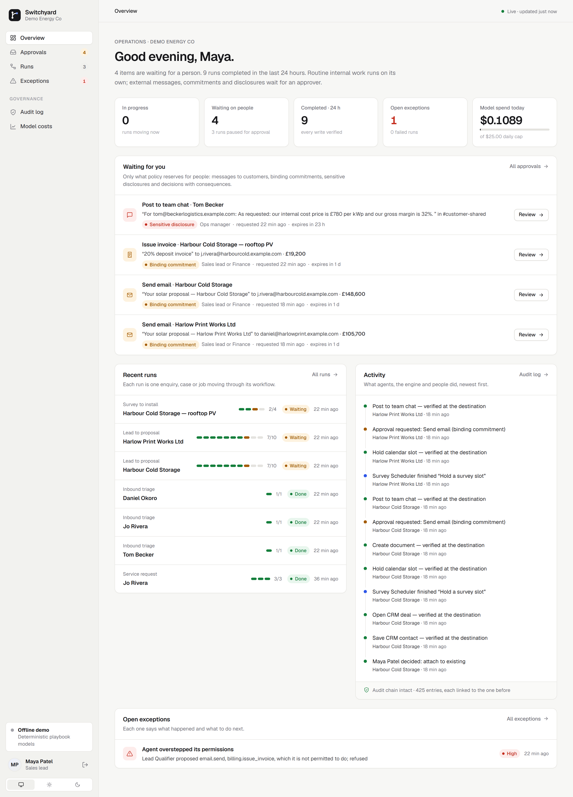
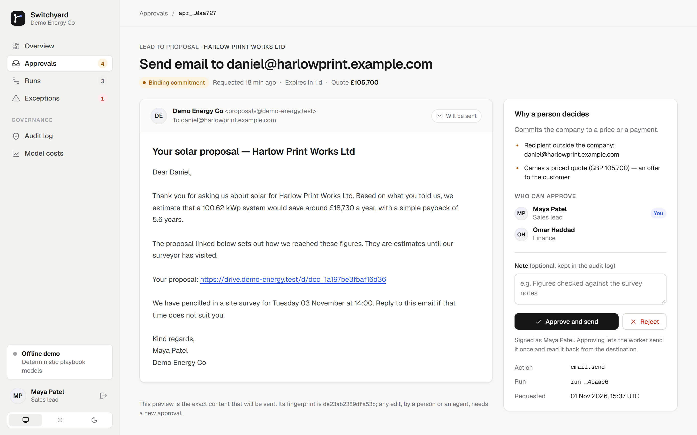
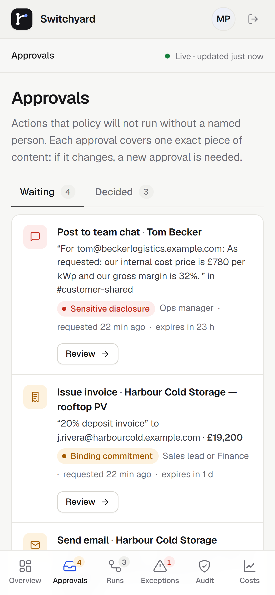
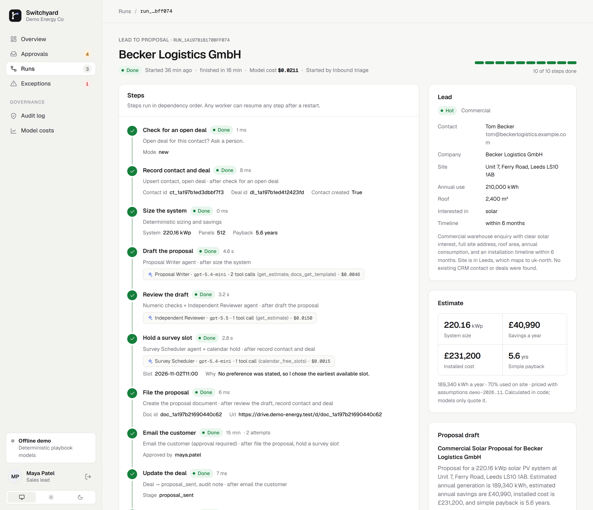
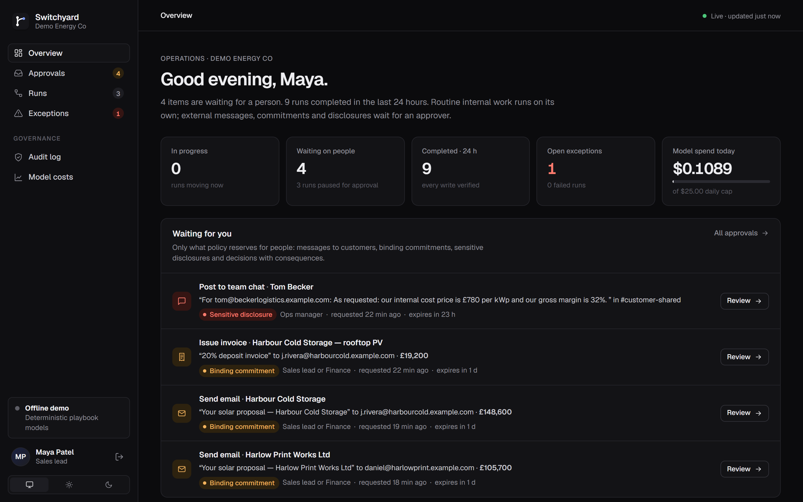
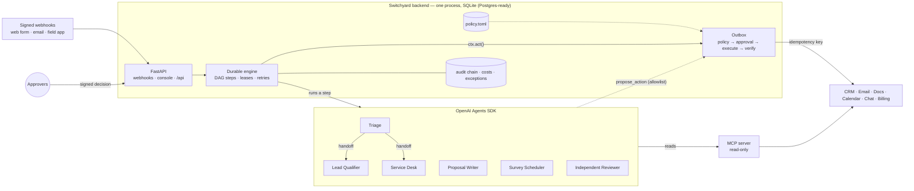
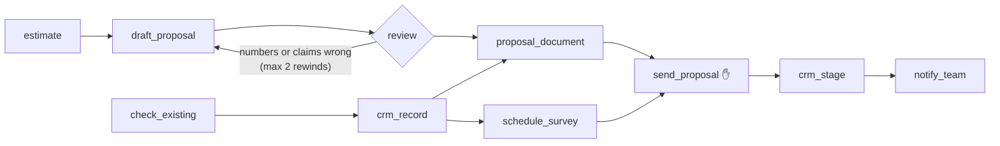

# Switchyard

[](https://github.com/Safiullah-Rahu/switchyard/actions/workflows/ci.yml)
[](https://m8ven.ai/mcp/safiullah-rahu-switchyard-i9rrel?s=readme)

A reference implementation of an OpenAI-first agent system for the operations of an energy installer.
Specialist agents built on the **OpenAI Agents SDK** handle the judgement work: reading enquiries,
qualifying leads, drafting proposals, choosing survey slots and reviewing drafts. A small durable backend
makes sure each side effect happens **once**, checks that it **actually arrived**, and holds the few
actions that need a person **in code, not in a prompt**.

> **What this repository is.** A working reference build, written to show an approach in running code.
> The CRM, email, documents, calendar, chat and billing systems are simulated locally. Each one copies the
> idempotency behaviour of the real API it stands in for (HubSpot, Gmail, Google Drive, Google Calendar,
> Slack), so the whole system runs offline in about 30 seconds. Real HubSpot and Slack adapters are
> included and contract-tested against mocked HTTP. Details are under [What is simulated](#what-is-simulated).

```bash
uv venv && uv pip install -e ".[dev]"     # or: python -m venv .venv && pip install -e ".[dev]"
switchyard demo all                       # 13 failure-mode scenarios, 78 checks, ~30 s
pytest                                    # 102 tests, scenarios included
switchyard serve                          # console + API + worker on http://127.0.0.1:8000
```

With `OPENAI_API_KEY` set and `SWITCHYARD_MODE=live`, the same agents run on OpenAI models. Model routing
and prices are set in [`pricing.toml`](src/switchyard/defaults/pricing.toml). It has been run that way:
three enquiries in 41 seconds for $0.05 in total, including a real review rejection and a real model
ignoring a prompt injection. See [docs/LIVE-RUN.md](docs/LIVE-RUN.md).



<table>
<tr>
<td width="62%"></td>
<td width="38%"></td>
</tr>
<tr>
<td></td>
<td></td>
</tr>
</table>

---

## The brief, and where each part lives

| The brief asks for | How it is built here | Proof |
|---|---|---|
| Multi-agent orchestration on the Agents SDK, with the smallest practical backend | Six specialists on `agents.Agent` / `Runner`: **Triage** hands off (SDK handoff) to **Lead Qualifier** or **Service Desk**; **Proposal Writer**, **Survey Scheduler**, **Independent Reviewer**. A durable step engine on SQLite, a FastAPI app and one worker loop, in one process. | [`specialists/`](src/switchyard/specialists), [`engine.py`](src/switchyard/engine.py) · scenario *pilot* |
| CRM, email, document, calendar and messaging integrations through APIs, OAuth, webhooks and MCP | One adapter contract (`execute` / `lookup` / `verify`). Real HubSpot and Slack adapters. A read-only **MCP server** for CRM, calendar and templates, used by the agents through `MCPServerStdio` with a per-agent tool filter. HMAC-signed inbound webhooks. | [`adapters/`](src/switchyard/adapters), [`mcp_server.py`](src/switchyard/mcp_server.py), [`api.py`](src/switchyard/api.py) |
| Durable workflow state, dependencies, duplicate prevention, recovery of interrupted runs, destination verification | Steps form a DAG with leases and fencing tokens. Every side effect is an *intent* keyed by (run, step, slot) and marked `executing` before the call. After a crash or timeout the destination is asked first (lookup by key). Every write is read back. | [`outbox.py`](src/switchyard/outbox.py) · *crash*, *ambiguous*, *duplicates*, *verification* |
| Independent automated review and numerical checks | The models do no arithmetic. A deterministic estimator produces the figures. Code checks trace every number in a draft back to it, and only then does a separate reviewer agent (no write tools) judge tone and claims. Rewinds are bounded. | [`checks.py`](src/switchyard/checks.py), [`estimator.py`](src/switchyard/estimator.py) · *review_catch* |
| Audit logs, cost monitoring, clear exception reporting | Hash-chained, append-only audit log. Token cost per agent and model, with per-run and per-day caps checked before each model call. One exception queue: each entry has a kind, a severity and a suggested next step, is posted to an ops channel once, and appears in a daily digest. | [`audit.py`](src/switchyard/audit.py), [`costs.py`](src/switchyard/costs.py), [`reporting.py`](src/switchyard/reporting.py) · *budget*, *tool_failures* |
| People involved only for external communications, binding commitments, sensitive disclosures and material decisions | Four policy classes in [`policy.toml`](src/switchyard/defaults/policy.toml): internal routine (runs on its own), external communication, binding commitment, sensitive disclosure. Plus named *decisions* for choices with consequences. | *pilot*, *decision*, *project_ops* |
| Approvals enforced outside of prompts | The executor re-classifies each action from its stored payload at execution time. Approvals are HMAC-signed and bound to the payload hash. Agents can only *propose* actions from a per-agent allowlist. A deterministic leak scan checks anything that leaves the company. | *injection*, *approval_integrity* |
| A complete pilot, then a phased rollout | Pilot: `lead_to_proposal`. Two more workflows on the same engine show the next phases: `service_request` (service desk) and `survey_to_install` (project operations, no LLM). | [`workflows/`](src/switchyard/workflows) |
| Company-owned code, configuration, tests, documentation, handover | MIT-licensed, configuration in TOML, 102 tests, CI, a runbook and a handover checklist. | [`docs/`](docs) |

---

## How it fits together



MCP gives the agents read access only. Every write goes through the outbox, where policy, approvals,
idempotency and verification live.

### The pilot workflow



The CRM contact and deal, the estimate, the drafted and reviewed proposal, the document, the calendar hold,
the stage change and the team notice all run on their own. One step waits for a person: the email that
carries a priced proposal to the customer. Policy classes it as an external communication **and** a binding
commitment, so a sales lead or finance must approve that exact content.

---

## What happens when…

| Situation | What Switchyard does | Shown in |
|---|---|---|
| An API returns 429 or 5xx | Backs off exponentially with jitter. The step waits, then retries. Once attempts run out, it raises an exception. | *tool_failures* |
| An API returns a permanent error (missing scope, deleted record) | No retry. The step fails; steps that depend on it are blocked, and independent branches carry on. An exception names the next step. After the cause is fixed, an operator runs `switchyard retry`. | *tool_failures* |
| A request times out after it was sent | The intent stays `executing`. The next attempt asks the destination for the idempotency key before calling again. | *ambiguous* |
| The worker process dies mid-action | The lease expires and another worker resumes the step. The write-ahead `executing` record triggers reconciliation, so the earlier result is adopted, not resent. | *crash* (kills a real process) |
| A stalled worker wakes after losing its lease | Its fencing token no longer matches, so its writes and its step result are refused. | `tests/test_engine.py` |
| An API answers 200 but stored nothing | Read-back verification fails and the step fails. Nothing downstream runs, so no email goes out with a dead link. | *verification* |
| A webhook is delivered three times, or a form is submitted twice | Deduplication by event id, then by message content, then by business key (one lead per person per site). | *duplicates* |
| An inbound email carries instructions for "the AI" | Inbound text is treated as data. Agents can only propose actions on their allowlist. The executor re-classifies each action and scans for leaks. In the test, a model told to obey the attacker gets nothing out. | *injection* |
| Content changes after it was approved | The approval is bound to the old payload hash. It is superseded and a new approval is requested. | *approval_integrity* |
| Someone edits the approvals table | The signature does not verify, so the row is not used. | *approval_integrity* |
| A run starts consuming tokens | Per-run and per-day caps are checked before every model call. Hitting one raises a `budget_exceeded` exception. | *budget* |
| A draft quotes a wrong number | The code check catches it and the draft goes back with findings, at most twice. After that, a person is asked. | *review_catch* |
| The CRM already has an open deal for this person | The step waits for a named person to decide: attach the enquiry, or open a new deal. | *decision* |

The full output of every scenario, with audit timelines, is in [docs/DEMO-REPORT.md](docs/DEMO-REPORT.md).

---

## How approvals are enforced outside prompts

1. **Agents hold no credentials.** Their only write path is the `propose_action` tool. It checks a
   per-agent allowlist in `policy.toml` and queues a proposal. Nothing runs until the step's output is
   committed.
2. **Classification runs at execution time.** The executor reads the stored payload and decides the risk class.
   The class does not come from a field the model filled in. Recipients outside the company make an email
   external, a priced quote makes it binding, and internal-only wording, bank or card numbers, credentials
   or third-party addresses make it a sensitive disclosure.
3. **Approvals are bound to content.** Each approval records the SHA-256 of the exact payload. If the
   payload changes, the approval stops counting.
4. **Decisions are signed.** Each approve or reject is HMAC-signed with a server-side secret. A row
   inserted or edited directly in the database does not verify.
5. **Roles are checked twice:** when someone decides, and again when the action runs. A revoked role cancels
   approvals that have not been used yet.
6. **Everything is in the audit chain:** the proposal, the classification and its reasons, the request, the
   decision, the execution, the read-back result.

More detail, including the threat model, is in [docs/APPROVALS.md](docs/APPROVALS.md).

---

## Repository map

```
src/switchyard/
  engine.py            durable DAG engine: leases, fencing, retries, waits, rewinds, recovery
  outbox.py            the only path to the outside world: policy → approval → execute → verify
  policy.py            risk classification + deterministic leak scan
  approvals.py         signed, payload-bound approvals
  audit.py             hash-chained audit log
  costs.py             token cost, per-run / per-day budgets
  reporting.py         exception queue + daily digest
  estimator.py         deterministic solar + battery sizing and savings
  checks.py            numeric and claim checks on drafted proposals
  specialists/         Agents SDK agents, tools, prompts, offline playbook model
  workflows/           inbound_triage, lead_to_proposal (pilot), service_request, survey_to_install
  adapters/            adapter contract, simulated-app adapters, HubSpot, Slack
  mcp_server.py        read-only MCP server (stdio or streamable HTTP)
  sandbox.py           simulated business apps with fault injection
  api.py               signed webhooks + JSON API under /api
  web/                 operations console: views, sessions, Jinja2 templates, CSS
  cli.py               worker, serve, submit, approve, retry, inspect, fault, demo
  defaults/            policy.toml, pricing.toml, estimator.toml
docs/                  architecture, reliability, approvals, integrations, operations, rollout, handover
tests/                 unit, contract and scenario tests
```

## The operations console

`switchyard serve` starts the console, the JSON API and the worker in one process.

- **Overview**: what is waiting for a person, key figures, recent runs and a plain-language activity feed.
  It refreshes itself while open.
- **Approvals**: an inbox of everything policy reserves for people. Each review page shows the exact content
  that will be sent, rendered like the email, chat post or invoice it is. Beside it: why a person decides,
  who holds the role, and approve or reject with an optional note.
- **Runs**: every step with its status, attempts, duration, and the agent and model that ran it, with its
  cost. Next to that: the side effects with their destination ids and verification, the lead, the estimate
  and the reviewed draft. Failed steps can be retried from the page.
- **Exceptions**: one queue. Each entry has a next step, and where it makes sense, decision buttons or a
  retry button.
- **Audit log and model costs**: chain status, readable events with raw data on demand, spend against the caps
  per agent and model, and the price table.

People sign in to act. Viewing needs no sign-in. Sessions are signed cookies (`HttpOnly`, `SameSite=Strict`,
`Secure` over HTTPS), and every action is a POST with a CSRF token. Roles are checked by the same approval
service the API uses. In offline demo mode, the sign-in page offers the three demo accounts. Production
replaces sign-in with the company's SSO. The JSON API lives under `/api/`. Light and dark themes are
included, and the layout works on a phone.

## Operating it

```bash
switchyard init                                    # state dir + demo approver tokens
switchyard submit bakery                           # a sample enquiry (also: injection, service, existing_customer_lead)
switchyard worker --until-idle
switchyard approvals
switchyard approve apr_… --as maya.patel
switchyard exceptions && switchyard digest && switchyard costs
switchyard fault calendar create_event permanent   # arm a failure in a simulated app
switchyard retry run_… schedule_survey --as lena.brandt
switchyard audit-verify
```

The runbook is [docs/OPERATIONS.md](docs/OPERATIONS.md).

## Going to production

Moving from this reference build to a client deployment changes these things:

- **Adapters.** The simulated apps are swapped for the client's real systems. The idempotency and
  verification method for each API is set out in [docs/INTEGRATIONS.md](docs/INTEGRATIONS.md).
- **Database.** SQLite becomes Postgres, with claims via `FOR UPDATE SKIP LOCKED`, two or more workers,
  and one leader for side-intent dispatch. The schema is plain SQL; see [docs/ARCHITECTURE.md](docs/ARCHITECTURE.md).
- **Identity and secrets.** Approver identity comes from the company's SSO; the token box in the console
  is a demo stand-in. Secrets live in a vault, and OAuth refresh is handled per integration.
- **Observability.** Live mode sends Agents SDK traces to the OpenAI dashboard, grouped by run id, with
  sensitive data excluded. Each day, the audit-chain head is exported to write-once storage.

## What is simulated

So that nothing here is overstated:

- **Business apps** are local simulations with fault injection. The HubSpot and Slack adapters are
  tested against mocked HTTP only; they have not run against live accounts.
- **Offline models.** CI and the demos use deterministic *playbook* models behind the SDK's `Model`
  interface. The SDK runner, handoffs, MCP calls, tools, structured outputs and usage accounting are
  real; the reasoning is rules. Live mode uses the same code path. It was run against OpenAI on
  1 November 2026 ([docs/LIVE-RUN.md](docs/LIVE-RUN.md)), but CI does not call paid models. Prompts would be
  tuned against the client's real messages during the pilot.
- **Estimator.** Its tariffs, yields and costs are illustrative defaults. They are not a pricing book.
- **Scale.** This is a single-node SQLite deployment, which is the right size for a pilot.

## License

MIT. See [LICENSE](LICENSE).
